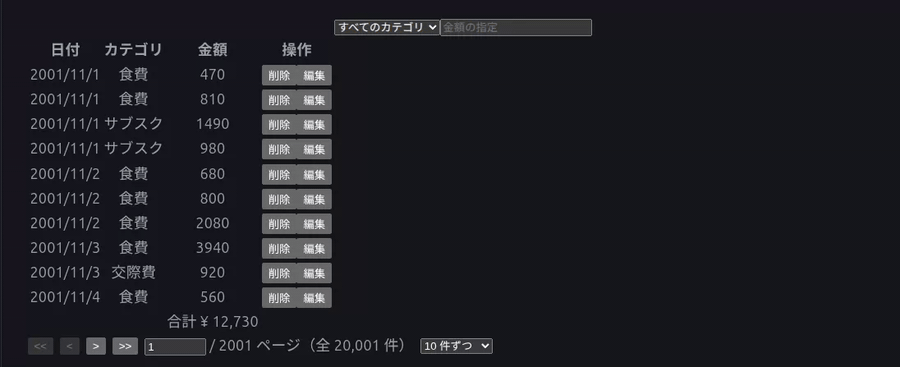
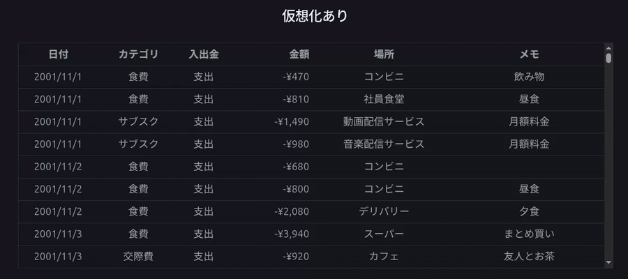
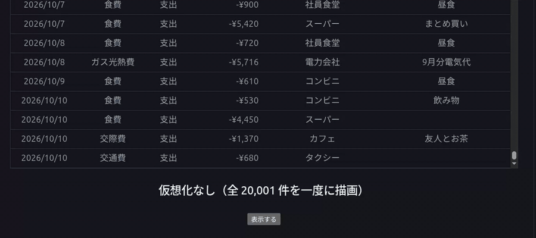

# TanStack ファミリーで作る大量データの一覧画面

TanStack DB・TanStack Table・TanStack Virtual を組み合わせたらUIサクサク動くんじゃねって思ったのでやってみました。

---

## 1. ライブラリ

### TanStack DB

API から取得したデータをフロントエンド側にコレクションとして保持し、コレクション同士の JOIN や楽観的な更新ができるライブラリです。内部では TanStack Query を使っています。

TanStack Query はデータをメモリに保持するのが基本でしたが、TanStack DB ではコレクションの種類を選ぶことで、保存先を選べるようになりました。

| コレクションの種類 | 保存先 |
| --- | --- |
| LocalOnly | メモリのみ（リロードすると消える） |
| LocalStorage | ブラウザの localStorage |
| IndexedDB | ブラウザの IndexedDB |

データはコレクションという単位で分けて保存します。**ライブクエリ（LiveQueryCollection）** を使うと、複数のコレクションを SQL のように JOIN して、リレーションを組み立てた結果を作れます。フロントエンド側の JSON 同士をリレーションでつなげられる、ということです。ライブクエリの結果はメモリ上に持ち、元のコレクションが変わると自動で更新されます。

詳しくは [〇〇さんの記事]() を参照してください。

リレーションが複雑になると、バックエンドでのクエリの実行に時間がかかってしまうことがあります。フロントエンド側である程度リレーションを組み立てる設計にすることで、改善できるかもしれないと思いました。

> 利点
>
> - 楽観的な更新ができるので、操作がすぐ画面に反映され、ユーザーのストレスを減らせる
> - 最初にまとめて取得しておけば、そのあとの操作ではデータの取得を待たずに済みことや機能ごとにAPIのリクエスト飛ばす必要がないので結果的にUX が向上する

運用するうえでは、データベースに何を選ぶのか、どこまでをフロントエンド側で管理するのかがテーマになりそうだと感じました。
一番適しているのは、複雑なリレーションがなく、大量のデータを扱う場合だと思います。たとえば、チャットの履歴や X のポストのように、NoSQL で保存されているような情報です。

また、GraphQL と組み合わせることもできますが、GraphQL ではフロントエンドでそのまま使える形のデータが返ってくるので、ライブクエリで組み立てる必要はあまりなく、TanStack DB のメリットを活かしにくいです。
ほかに、DB の更新をリアルタイムに同期するコレクション（Electric、PowerSync、RxDB、TrailBase など）もあります。

### TanStack Virtual

大量のデータを一覧に描画するときに使うライブラリです。

1 万件のデータをそのまま描画すると重くなりますが、TanStack Virtual は**画面に見えている行だけ**を DOM にするので、スムーズにスクロールできます。Slack や LINE のトーク履歴はページ分けされていないのにさくさくスクロールできますが、これと同じように、いまどの位置までスクロールしているかを内部で監視して、描画する行を判断しています。

#### Virtualizer の仕組み

中心になるのは `useVirtualizer` が返す **Virtualizer** です。Virtualizer はデータそのものを持たず、「何件あるか」と「1 行の高さ」だけを知っています。スクロール位置を監視して、**いま見えている範囲に入る行の番号と位置**を計算します。

1. 全行分の高さ（`getTotalSize()`）を持つ空の箱を作り、スクロールバーを本来の長さにする
2. スクロールするたびに、スクロール位置と行の高さから「何行目から何行目が見えているか」を計算する
3. その範囲の行（`getVirtualItems()`）だけを描画し、各行を本来の位置（`item.start`）に配置する

```tsx
const parentRef = useRef<HTMLDivElement>(null);
const virtualizer = useVirtualizer({
  count: items.length, // 全部で何行あるか
  getScrollElement: () => parentRef.current, // スクロールを監視する要素
  estimateSize: () => ROW_HEIGHT, // 1 行の高さの見積もり
  overscan: 20, // 見えている範囲の前後に余分に描画する行数
});

return (
  <div ref={parentRef} style={{ height: 400, overflow: "auto" }}>
    {/* 全行分の高さを確保する */}
    <div style={{ height: virtualizer.getTotalSize(), position: "relative" }}>
      {/* 見えている範囲の行だけを描画する */}
      {virtualizer.getVirtualItems().map((item) => (
        <div
          key={item.key}
          data-index={item.index} // 何行目かを Virtualizer に伝える
          ref={virtualizer.measureElement} // 実際の高さを測る
          style={{
            position: "absolute",
            top: 0,
            left: 0,
            width: "100%",
            transform: `translateY(${item.start}px)`, // 本来の位置に置く
          }}
        >
          {items[item.index].memo}
        </div>
      ))}
    </div>
  </div>
);
```

| オプション・メソッド | 役割 |
| --- | --- |
| `count` | 全部で何行あるか。データ本体は渡さない |
| `getScrollElement` | スクロール位置を監視する要素 |
| `estimateSize` | 1 行の高さの見積もり。全体の高さと位置の計算に使う |
| `overscan` | 見えている範囲の前後に余分に描画する行数。速くスクロールしても空白が見えにくくなる |
| `getTotalSize()` | 全行分の高さ。スクロールバーの長さになる |
| `getVirtualItems()` | いま描画すべき行の一覧。`index`（何行目か）、`start`（上からの位置）、`key` を持つ |
| `measureElement` | 描画した行の実際の高さを測り、見積もりとずれていれば位置を計算し直す。`data-index` が必要 |

Virtualizer は「何行目をどこに置くか」を計算するだけで、行の中身や見た目には関わりません。そのため、テーブルの行でもチャットのメッセージでも、同じ仕組みで使えます。

> メリット
>
> - 大量のデータでも描画が重くならない
> - API 側でページングをしなくてもよい

想定される利用ケース

- 就活支援サービスで大量の企業を一覧にする
- EC サイトで商品を大量に並べる
- ログをダッシュボードに表示する
- チャットや掲示板のような機能

ページ分けをしないと「どこまで確認したか」が分かりにくくなりますが、そこは TanStack Table の絞り込みや並び替えで補えると考えています。

### TanStack Table

多機能なテーブルを作るためのライブラリです。見た目は持たず、ロジックだけを提供します。

- 並び替え（複数列も可）
- 絞り込み・検索
- 列の表示・非表示
- グループ化・行の展開（SQL の GROUP BY のような動き）
- 集計（合計など）
- ページ分け
- 並び替えや絞り込みをサーバー側の API に任せることも可能

テーブルは **Feature** と **Column** の 2 つで組み立てます。`useTable` に、この 2 つと表示するデータを渡します。

```ts
const table = useTable({
  features: features, // どの機能を使うか（テーブル全体）
  columns: columns, // 列ごとの定義
  data: transactions, // API などで取得したデータ（今回は TanStack DB のライブクエリの結果）
});
```

- **Feature**：テーブル全体で「この機能とこの関数を使えるようにする」と宣言する
- **Column**：列ごとに「この列ではどの関数を使うか、使わないか」を選ぶ

よいところは、データを絞り込んだり並べ替えたりする処理を自分で書かなくても、宣言するだけで使えることです。

#### Feature：テーブル全体で使う機能を宣言する

v8 までは、並び替えや絞り込みなどの機能が最初から全部入っていました。v9 では、`tableFeatures()` で**使う機能だけを宣言する**形に変わりました。宣言しなかった機能はバンドルに含まれず、型にも出てきません。たとえば並び替えを宣言しないと、`column.toggleSorting()` を書いた時点で型エラーになります。

```ts
const features = tableFeatures({
  // 機能本体
  columnFilteringFeature,
  rowSortingFeature,
  rowPaginationFeature,
  rowAggregationFeature,
  // 行モデル（実際に行を絞る・並べる・ページに切る処理）
  filteredRowModel: createFilteredRowModel(),
  sortedRowModel: createSortedRowModel(),
  paginatedRowModel: createPaginatedRowModel(),
  // Column から名前で呼べる関数の登録
  filterFns: {
    includesString: filterFn_includesString,
    equalsString: filterFn_equalsString,
    greaterThan: filterFn_greaterThan,
  },
  sortFns: {
    alphanumeric: sortFn_alphanumeric,
    text: sortFn_text,
    datetime: sortFn_datetime,
    basic: sortFn_basic,
  },
  aggregationFns: { sum: aggregationFn_sum },
});
```

| 種類 | 中身 | 役割 |
| --- | --- | --- |
| 機能本体 | `columnFilteringFeature` など | 絞り込み・並び替え・ページ分け・集計を使えるようにする |
| 行モデル | `filteredRowModel` など | 実際に行を絞る・並べる・ページに切る |
| 関数の登録 | `filterFns` / `sortFns` / `aggregationFns` | Column から名前で選べる比較・集計の関数 |

#### Column：列ごとに表示と使う機能を決める

`createColumnHelper` で Feature と行の型をひも付け、列ごとに表示する値と使う機能を指定します。

```tsx
const columnHelper = createColumnHelper<typeof features, TransactionRow>();

const TransactionColumns = columnHelper.columns([
  columnHelper.accessor((row) => row.categoryName ?? "未分類", {
    id: "category",
    header: "カテゴリ",
    sortFn: "text", // Feature の sortFns に登録した名前
    enableColumnFilter: true,
    filterFn: "includesString", // Feature の filterFns に登録した名前
  }),
  columnHelper.accessor("amount", {
    header: "金額",
    sortFn: "alphanumeric",
    filterFn: "greaterThan",
    aggregationFn: "sum",
    footer: ({ column, table }) =>
      `合計 ¥ ${column
        .getAggregationValue<number>({ rows: table.getRowModel().rows })
        .toLocaleString()}`,
  }),
]);
```

| 項目 | 例（カテゴリ列） | 意味 |
| --- | --- | --- |
| 値の取り出し方 | `(row) => row.categoryName ?? "未分類"` | 行データからこの列の値を作る |
| `header` / `footer` / `cell` | `header: "カテゴリ"` | 見出し・合計行・セルの表示 |
| `sortFn` / `filterFn` | `"text"` / `"includesString"` | Feature に登録した関数から選ぶ |
| `enableColumnFilter` など | `true` | この列でその機能を使うかどうか |

Column で指定できる関数は、Feature に登録したものだけです。金額列の `filterFn: "greaterThan"` は、Feature の `filterFns` に `greaterThan` を登録してあるから指定できます。登録していない名前を書くと型エラーになります。

並び替えや絞り込みといった情報を複雑なロジックなしに実行することができ、かつユーザー自身がデータの形状を変えることができるライブラリです。

---

## 2. 実装

どうせフロントエンド側で結合するのであれば、データベースはリレーションを持たないキーバリューストア（NoSQL）のほうが相性がよいと考え、今回は MongoDB で実装しました。

### 技術スタック

| 領域 | 技術 | バージョン |
| --- | --- | --- |
| フロントエンド | React | 19.3.0 |
| | Vite / TypeScript | 8.3.4 / 6.0.3 |
| | @tanstack/react-db（@tanstack/db） | 0.5.8（0.13.0） |
| | @tanstack/query-db-collection | 1.4.3 |
| | @tanstack/react-table | 9.2.8 |
| | @tanstack/react-virtual | 3.14.14 |
| バックエンド | Python / FastAPI / pymongo | 3.14 / 0.143.0 / 4.18.3 |
| DB | MongoDB | 8 |

### データの流れ

```
MongoDB（transactions / categories）
   │  そのまま保存。JOIN はしない
   ▼
FastAPI（GET /transactions, GET /categories ...）
   │  条件を付けずに全件返す
   ▼
TanStack DB
   ├ transactionCollection（一覧データ 2 万件）
   ├ categoryCollection（カテゴリ）
   └ transactionHistoryCollection（ライブクエリで JOIN してカテゴリ名を付ける）
   │
   ├──▶ TanStack Table … 並び替え・絞り込み・集計・ページ分け
   ├──▶ TanStack Virtual … 仮想スクロールで全件表示
   └──▶ 仮想化なしのテーブル … 比較用に全件を一度に描画
```

MongoDB には一覧データとカテゴリをひたすら保存し、API ではそのまま抜き出しています。コレクションで一覧データとカテゴリを保持し、ライブクエリでそれらを JOIN します。ここまで条件分岐を一切していないので、受け取るデータ量は少し大きめです。

条件が変わるたびに API を呼ぶと、データの取得と描画が連続で発生してしまいます。UI の変更を柔軟に反映するには、一度に取ってしまうほうがよいと考えました。絞り込みや検索は TanStack Table に任せることで、ユーザーが見たい情報をその場で探せるイメージです。

### 主なコード

ライブクエリで一覧データとカテゴリを JOIN する部分です。

```ts
export const transactionHistoryCollection = createLiveQueryCollection({
  id: "transaction-rows",
  query: (q) =>
    q
      .from({ t: transactionCollection })
      .leftJoin({ c: categoryCollection }, ({ t, c }) => eq(t.categoryId, c.id))
      .select(({ t, c }) => ({
        id: t.id,
        date: t.date,
        amount: t.amount,
        categoryId: t.categoryId,
        categoryName: c?.name,
        kind: t.kind,
        place: t.place,
        memo: t.memo,
      })),
  getKey: (row) => row.id,
});
```

---

## 3. 2 万件のデータで試した結果

### テーブルを 3 種類並べて比較

| テーブル | 描画する行 | 特徴 |
| --- | --- | --- |
| TanStack Table（ページ分け） | 1 ページ分（10〜100 行） | 並び替え・絞り込み・集計ができる |
| TanStack Virtual | 画面に見えている行 + 前後 20 行 | 全件をスクロールで見られる |
| 仮想化なし | 20,001 行すべて | 比較用。表示するとかなり重い |

### 映像で比較

同じ 2 万件のデータを、3 種類のテーブルで表示したときの様子です。

#### TanStack Table（ページ分け）



#### TanStack Virtual



#### 仮想化なし



---

## 4. まとめ

- TanStack DB で「取得したデータの組み立て」をフロントに寄せると、API の呼び出しを減らして UI を柔軟に変えられる
- TanStack Table と TanStack Virtual で、大量のデータでも操作しやすく、軽く表示できる
- ただし全件を取得する構成には限界があるので、範囲の絞り込みはバックエンドで行うのが現実的


### コメント
TanstackのFamilyはまだまだいますが、どれも一つ一つ機能を組み立てていく実感があるライブラリで勉強していて楽しかったと感じています。本当は最近リリースされたTanstack Chartを主軸に扱おうと思っていたのですが、組み合わせが難しかったです。特に親和性が良さそうなモノで絞って紹介してみました。

<!-- 

## アーキテクチャについて（未完成）
そもそもの思想としてフロントエンドのためにバックエンドのアーキテクチャを変えてしまうのはいかがなものなのかと若輩者ながらに感じておりますが、３つのライブラリを使う場合には視野に入れる必要があるかもしれないです。

### 今後検討したいこと

- 一覧 API に期間指定やページングを付けて、取得量を抑える
- レンダリング方式：CSR（SPA）か SSR か
- API の方式：REST / GraphQL / RPC
- DB：RDB か NoSQL か
- データの保存場所：メモリ、localStorage（5MB まで）、sessionStorage、IndexedDB、Cookie、Cache API、OPFS、URL のクエリパラメータ
- TanStack DB のコレクションの種類
  - LocalOnly / LocalStorage / IndexedDB
  - リアルタイム同期系：Electric、PowerSync、RxDB、TrailBase


### 基本方針

**「バックエンドで範囲を絞り、その範囲内をフロントエンドで自由に操作する」** 二段構えにします。

- バックエンド：決めておいた数パターンの条件だけを、認可したうえで高速に返す
- フロントエンド：取得した範囲（ブラウザに載る量）に対して、JOIN・並び替え・絞り込み・グループ化を自由に行う
- 描画：仮想スクロールで、見えている行だけを DOM にする

### 絞り込み条件を 2 種類に分ける

| 種類 | UI | 処理する場所 | 条件を変えたとき |
| --- | --- | --- | --- |
| **範囲条件** | 表の上のフィルタ（期間・ステータスなど） | バックエンド | API を呼び直す |
| **表内操作** | ヘッダーでの並び替え、列ごとの絞り込み | TanStack Table（ブラウザ内） | API は呼ばない |

範囲条件は「ブラウザに載る量まで減らす」ため、表内操作は「載ったデータを自由に見る」ためのものです。

### 役割分担

| 処理 | 担当 |
| --- | --- |
| 範囲の絞り込み・決まったパターンの並び替え | バックエンド |
| 書き込みの検証・データの整合性 | バックエンド |
| 全期間の集計などの大きな処理 | バックエンド |
| 表示用の行の組み立て（JOIN） | TanStack DB |
| 楽観的な更新 | TanStack DB |
| 取得した範囲内での並び替え・絞り込み・グループ化 | TanStack Table |
| 描画 | TanStack Virtual |

### 守るべき原則

- **ブラウザに渡したデータは、ユーザーに見える前提で扱う。** 
- **クライアントからの書き込みは信用しない。** 
- **バックエンドに任せる条件は数パターンに絞る。** 

### NoSQL 側の設計

- **アクセスパターンを先に決め、それぞれにインデックスを用意する**（例：ステータス + 作成日の降順）
- **エンティティごとに分けて保存する。** TanStack DB は正規化されたコレクション同士を JOIN する前提のため
- **キーを統一する。** MongoDB の `_id`（ObjectId）は API で文字列にして返す
- **JOIN 先の列でバックエンド側の並び替えが必要なときだけ、非正規化する**
- Firestore / DynamoDB は読み出し件数で課金されるので、画面を開くたびに全件取得しない

### この構成が成り立つ条件

| 条件 | 成り立たない場合 |
| --- | --- |
| 範囲で絞った件数がブラウザに載る（数千〜1 万件程度） | 範囲をさらに細かくする、または表内操作の一部をバックエンドに移す |
| バックエンドで行う並び替え・絞り込みが数パターンに収まる | RDB を検討する |
| 部分一致検索が取得した範囲内で足りる | 検索エンジンを導入する |

この構成はバックエンドを含めたアーキテクチャ全体に影響するので、一度選ぶと後から戻すのが難しい点に注意が必要です。

---
 -->